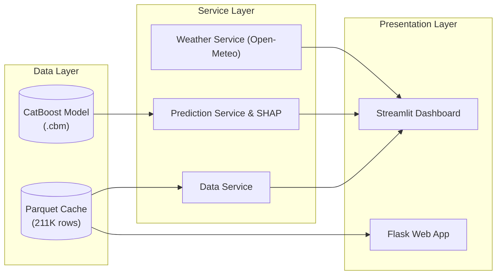

# 🌾 Indian Agriculture — Crop Yield Prediction System

Predict crop yield (tonnes/hectare) for Indian agriculture using historical crop production data (2001–2020), real-time weather data from [Open-Meteo API](https://open-meteo.com/), and a **CatBoost** machine learning model.

## 📋 Table of Contents

- [Features](#features)
- [Architecture](#architecture)
- [Project Structure](#project-structure)
- [Tech Stack](#tech-stack)
- [Setup & Installation](#setup--installation)
- [Usage](#usage)
- [Data Sources](#data-sources)
- [Screenshots](#screenshots)
- [Results](#results)
- [Future Improvements](#future-improvements)
- [License](#license)

## ✨ Features

- **Crop Yield Prediction**: Predict yield for 90+ crops across 685 districts in 33 Indian states
- **Live Weather Integration**: Fetches real-time historical weather data via Open-Meteo API
- **Dual Frontend**: Both Flask web app and Streamlit interactive dashboard
- **Unit Conversion**: Supports 22 Indian land measurement units (hectare, bigha, kanal, etc.)
- **Multi-Crop Comparison**: Predict and compare yields for multiple crops simultaneously
- **Weather Visualization**: Interactive weather trend charts with Plotly.js
- **Model Interpretability**: SHAP explanations integrated directly into the dashboard

## 🏗️ Architecture



## 📁 Project Structure

```
Indian_Agriculture-main/
├── data/
│   ├── raw/                    # Original source data (APY datasets)
│   └── processed/              # Final clean data for apps
├── models/                     # Trained CatBoost model (.cbm) & meta
├── checkpoints/                # Encoded datasets and splits (Parquet/Npy)
├── notebooks/
│   ├── 01_EDA.ipynb                   # Exploratory Data Analysis
│   ├── 02_Data_Preprocessing.ipynb    # Feature Scaling & Target Transforms
│   ├── 03_Feature_Engineering.ipynb   # Geo-clustering & Feature Creation
│   ├── 04_Model_Training.ipynb        # CatBoost Training Pipeline
│   ├── 05_Model_Comparison.ipynb      # Leaderboard evaluation
│   ├── 06_SHAP_Analysis.ipynb         # SHAP TreeExplainer Interpretation
│   └── 07_Final_Evaluation.ipynb      # Residual Analysis & Errors
├── src/
│   ├── config/                 # Environment-based configuration
│   ├── services/               # Weather API, ML Inference, Data Lookups
│   ├── utils/                  # Land-area unit conversions, PDF exports
│   ├── flask_app/              # Flask web application
│   └── streamlit_app/          # Streamlit dashboard
├── tests/                      # Test suite
├── docs/                       # Documentation
├── .env.example                # Environment variable template
├── .gitignore
├── requirements.txt
└── README.md
```

## 🛠️ Tech Stack

| Layer | Technology |
|---|---|
| ML Model | CatBoost Regressor, SHAP |
| Backend | Flask, Gunicorn |
| Dashboard | Streamlit, Plotly.js |
| Data | Pandas, NumPy, Parquet |
| Weather API | Open-Meteo (Historical Archive) |
| Config | python-dotenv |

## 🚀 Setup & Installation

### Prerequisites
- Python 3.9+
- pip

### Steps

```bash
# 1. Clone the repository
git clone https://github.com/your-username/Indian_Agriculture.git
cd Indian_Agriculture-main

# 2. Create virtual environment
python -m venv venv
source venv/bin/activate  # Linux/Mac
# or: venv\Scripts\activate  # Windows

# 3. Install dependencies
pip install -r requirements.txt

# 4. Configure environment
cp .env.example .env
# Edit .env and enter any required configurations
```

## 📖 Usage

### Streamlit Dashboard (Recommended)

```bash
streamlit run src/streamlit_app/app.py
# Opens automatically in browser
```

### Flask Web App

```bash
python -m src.flask_app.app
# Open http://localhost:5000
```

## 📸 Screenshots

*Include screenshots of the Streamlit dashboard, predictions, weather analytics, and SHAP visualisations here.*

## 📈 Results

The final machine learning pipeline uses **CatBoost Regressor** trained on a carefully engineered 60-feature dataset (incorporating historical weather and geo-clusters).
- **R² Score**: ~ 0.6047
- **RMSE**: ~ 10.01
- **MAE**: ~ 1.42

## 🔮 Future Improvements

- Add support for real-time future weather forecasting.
- Integrate soil health data APIs for improved feature representation.
- Containerize the application via Docker for easier deployment.
- CI/CD pipeline implementation.

## 📊 Data Sources

| Source | Description | URL |
|---|---|---|
| India Data Portal | Crop area, production, yield (APY) data | [Link](https://ckandev.indiadataportal.com/dataset/area-production-yield-apy/resource) |
| Open-Meteo | Historical weather data (temperature, precipitation, humidity, wind) | [Link](https://open-meteo.com/) |

**Dataset Coverage**: 33 states, 685 districts, 90+ crops, 6 seasons, 2001–2020

## 📄 License

This project is for educational purposes.
